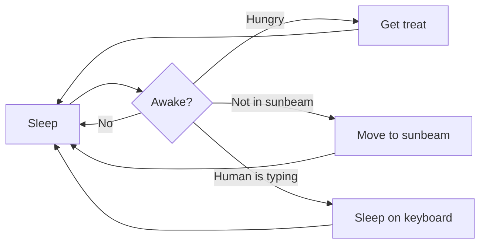

Here is a sample of some basic Markdown syntax that can be used when writing Markdown content in Astro.

Math test

This sentence uses `$` delimiters to show math inline: $\sqrt{3x-1}+(1+x)^2 + \sqrt{3x-1}+(1+x)^2 + \sqrt{3x-1}+(1+x)^2 + \sqrt{3x-1}+(1+x)^2$

$$
\left( \sum_{k=1}^n a_k b_k \right)^2 \leq \left( \sum_{k=1}^n a_k^2 \right) \left( \sum_{k=1}^n b_k^2 \right)
$$

codeblock

```math
\left( \sum_{k=1}^n a_k b_k \right)^2
```

lists

1. Main step
   1. Sub-step A
   2. Sub-step B
      1. Sub-sub step A
2. Next step
   1. Code

      ```rust
      let mut x = 0;
      ```
   - Bullet note
   1. With table
      | Italics | Bold | Code | | --------- | -------- | ------ |
      | _italics_ | **bold** | `code` |

- After table

<ol type="I">
  <li>uppercase</li>
  <li>roman</li>
</ol>

<ol type="i">
  <li>lowercase</li>
  <li>roman</li>
</ol>

<ol type="A">
  <li>uppercase</li>
  <li>alpha</li>
</ol>

<ol type="a">
  <li>lowercase</li>
  <li>alpha</li>
</ol>

- super
  - nested
    - list
      - even
        - more!
          - lol

GitHub checklists below

- [ ] Foo
- [ ] Bar
  - [ ] Baz
  - [x] Completed

Definitions list below (requires enabling satteri's `definitionList` feature )

<strong>Lower cost</strong>
: The new version of this product costs significantly less than the previous one!

<strong>Easier to use</strong>
: We've changed the product so that it's much easier to use!

<strong>Safe for kids</strong>
: You can leave your kids alone in a room with this product and they
won't get hurt (not a guarantee).

<!-- can this be done without inline html? -->

definitions list with inline html

<dl>
  <dt><strong>Lower cost</strong></dt>
  <dd>The new version of this product costs significantly less than the previous one!</dd>
  <dt><strong>Easier to use</strong></dt>
  <dd>We've changed the product so that it's much easier to use!</dd>
  <dt><strong>Safe for kids</strong></dt>
  <dd>You can leave your kids alone in a room with this product and they
      won't get hurt (not a guarantee).</dd>
</dl>

Blockquote below

> [!NOTE]
> Useful information that users should know, even when skimming content.

> [!TIP]
> Helpful advice for doing things better or more easily.

> [!IMPORTANT]
> Key information users need to know to achieve their goal.

> [!WARNING]
> Urgent info that needs immediate user attention to avoid problems.

> [!CAUTION]
> Advises about risks or negative outcomes of certain actions.
>
> Another line
>
> Aaaaand another line
>
> Yes

With inline code: `let mut x = 0;` after inline code

mermaid



summary with disclosure

<details>
  <summary>Click here to view details</summary>
  <p>This hidden content appears when the user clicks the summary.</p>
</details>

Divider

---

## Heading + `inline code` + divider + [Homepage link](/)

---

test

## Headings

The following HTML `<h1>`—`<h6>` elements represent six levels of section headings. `<h1>` is the highest section level while `<h6>` is the lowest.

# H1

## H2

### H3

#### H4

##### H5

###### H6

## Paragraph

Xerum, quo qui aut unt expliquam qui dolut labo. Aque venitatiusda cum, voluptionse latur sitiae dolessi aut parist aut dollo enim qui voluptate ma dolestendit peritin re plis aut quas inctum laceat est volestemque commosa as cus endigna tectur, offic to cor sequas etum rerum idem sintibus eiur? Quianimin porecus evelectur, cum que nis nust voloribus ratem aut omnimi, sitatur? Quiatem. Nam, omnis sum am facea corem alique molestrunt et eos evelece arcillit ut aut eos eos nus, sin conecerem erum fuga. Ri oditatquam, ad quibus unda veliamenimin cusam et facea ipsamus es exerum sitate dolores editium rerore eost, temped molorro ratiae volorro te reribus dolorer sperchicium faceata tiustia prat.

Itatur? Quiatae cullecum rem ent aut odis in re eossequodi nonsequ idebis ne sapicia is sinveli squiatum, core et que aut hariosam ex eat.

## Images

### Syntax

```markdown

```

### Output


with figure/caption

## Blockquotes

The blockquote element represents content that is quoted from another source, optionally with a citation which must be within a `footer` or `cite` element, and optionally with in-line changes such as annotations and abbreviations.

### Blockquote without attribution

#### Syntax

```markdown
> Tiam, ad mint andaepu dandae nostion secatur sequo quae.
> **Note** that you can use _Markdown syntax_ within a blockquote.
```

#### Output

> Tiam, ad mint andaepu dandae nostion secatur sequo quae.
> **Note** that you can use _Markdown syntax_ within a blockquote.

> Blockquote
>
> > nested blockquote
> >
> > another line
> >
> > > further nested blockquote
>
> TODO: add more spacing between lines and nested blockquotes

### Blockquote with attribution

#### Syntax

```markdown
> Don't communicate by sharing memory, share memory by communicating.<br />
> — <cite>Rob Pike[^1]</cite>
```

#### Output

> Don't communicate by sharing memory, share memory by communicating.<br />
> — <cite>Rob Pike[^1]</cite>

[^1]: The above quote is excerpted from Rob Pike's [talk](https://www.youtube.com/watch?v=PAAkCSZUG1c) during Gopherfest, November 18, 2015.

## Tables

### Syntax

```markdown
| Italics   | Bold     | Code   |
| --------- | -------- | ------ |
| _italics_ | **bold** | `code` |
```

### Output

| Italics   | Bold     | Code   |
| --------- | -------- | ------ |
| _italics_ | **bold** | `code` |

space

| First Header | Second Header |
| ------------ | ------------- |
| x            | x             |
| x            | x             |

Colons can be used to align columns.

| Tables        |      Are      |  Cool |
| ------------- | :-----------: | ----: |
| col 3 is      | right-aligned | $1600 |
| col 2 is      |   centered    |   $12 |
| zebra stripes |   are neat    |    $1 |

There must be at least 3 dashes separating each header cell.
The outer pipes (|) are optional, and you don't need to make the
raw Markdown line up prettily. You can also use inline Markdown.

| Markdown | Less      | Pretty     |
| -------- | --------- | ---------- |
| _Still_  | `renders` | **nicely** |
| 1        | 2         | 3          |

| First Header | Second Header |
| ------------ | ------------- |
| Content Cell | Content Cell  |
| Content Cell | Content Cell  |

| Command    | Description                                    |
| ---------- | ---------------------------------------------- |
| git status | List all new or modified files                 |
| git diff   | Show file differences that haven't been staged |

| Command      | Description                                        |
| ------------ | -------------------------------------------------- |
| `git status` | List all _new or modified_ files                   |
| `git diff`   | Show file differences that **haven't been** staged |

| Left-aligned | Center-aligned | Right-aligned |
| :----------- | :------------: | ------------: |
| git status   |   git status   |    git status |
| git diff     |    git diff    |      git diff |

| Name     | Character |
| -------- | --------- |
| Backtick | `         |
| Pipe     | \|        |

## Code Blocks

### Syntax

we can use 3 backticks ``` in new line and write snippet and close with 3 backticks on new line and to highlight language specific syntax, write one word of language name after first 3 backticks, for eg. html, javascript, css, markdown, typescript, txt, bash

````markdown
```html
<!doctype html>
<html lang="en">
  <head>
    <meta charset="utf-8" />
    <title>Example HTML5 Document</title>
  </head>
  <body>
    <p>Test</p>
  </body>
</html>
```
````

````markdown
```ts
interface User {
  id: number;
  name: string;
  email: string;
}

async function fetchUser(id: number): Promise<User> {
  const res = await fetch(`/api/users/${id}`);
  if (!res.ok) throw new Error("User not found");
  return res.json();
}
```
````

```js title="line-markers.js" del={2} ins={3-4} {6}
function demo() {
  console.log("this line is marked as deleted");
  // This line and the next one are marked as inserted
  console.log("this is the second inserted line");

  return "this line uses the neutral default marker type";
}
```

### Output

```html
<!doctype html>
<html lang="en">
  <head>
    <meta charset="utf-8" />
    <title>Example HTML5 Document</title>
  </head>
  <body>
    <p>Test</p>
  </body>
</html>
```

```ts
interface User {
  id: number;
  name: string;
  email: string;
}

async function fetchUser(id: number): Promise<User> {
  const res = await fetch(`/api/users/${id}`);
  if (!res.ok) throw new Error("User not found");
  return res.json();
}
```

## List Types

### Ordered List

#### Syntax

```markdown
1. First item
2. Second item
3. Third item
```

#### Output

1. First item
2. Second item
3. Third item

### Unordered List

#### Syntax

```markdown
- List item
- Another item
- And another item
```

#### Output

- List item
- Another item
- And another item

### Nested list

#### Syntax

```markdown
- Fruit
  - Apple
  - Orange
  - Banana
- Dairy
  - Milk
  - Cheese
```

#### Output

- Fruit
  - Apple
  - Orange
  - Banana
- Dairy
  - Milk
  - Cheese

## Other Elements — abbr, sub, sup, kbd, mark

### Syntax

```markdown
<abbr title="Graphics Interchange Format">GIF</abbr> is a bitmap image format.

H<sub>2</sub>O

X<sup>n</sup> + Y<sup>n</sup> = Z<sup>n</sup>

Press <kbd>CTRL</kbd> + <kbd>ALT</kbd> + <kbd>Delete</kbd> to end the session.

Most <mark>salamanders</mark> are nocturnal, and hunt for insects, worms, and other small creatures.
```

### Output

<abbr title="Graphics Interchange Format">GIF</abbr> is a bitmap image format.

H<sub>2</sub>O

X<sup>n</sup> + Y<sup>n</sup> = Z<sup>n</sup>

Press <kbd>CTRL</kbd> + <kbd>ALT</kbd> + <kbd>Delete</kbd> to end the session.

Most <mark>salamanders</mark> are nocturnal, and hunt for insects, worms, and other small creatures.
